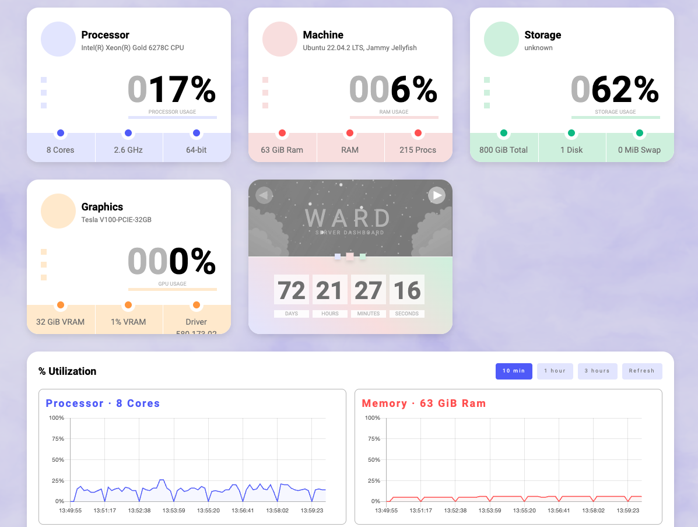

<h3 align = "center">
    
</h3>

---

### About

originally from WARD

Useing [OSHI](https://github.com/oshi/oshi) for cpu，memo and disk inspection

I added Nvidia-smi-tool-kit for nvidia GPU inspection and history display bars for all resources.

**All features tested on:** `Windows` `Linux`

    

<h6 align = "center">Preview Image</h6>

---

### Installation

    Create your own .jar

    • Clone the project
    • Import project in your IDE as Maven project
    • mvn clean package

 

    Run .jar file

    • Download latest .jar from releases section
    • Execute jar on Windows or Linux with administrative rights
    • Enter localhost:4000 and set up application
    • if you want GPU inspection function make sure there is Nvidia-smi-tool-kit
